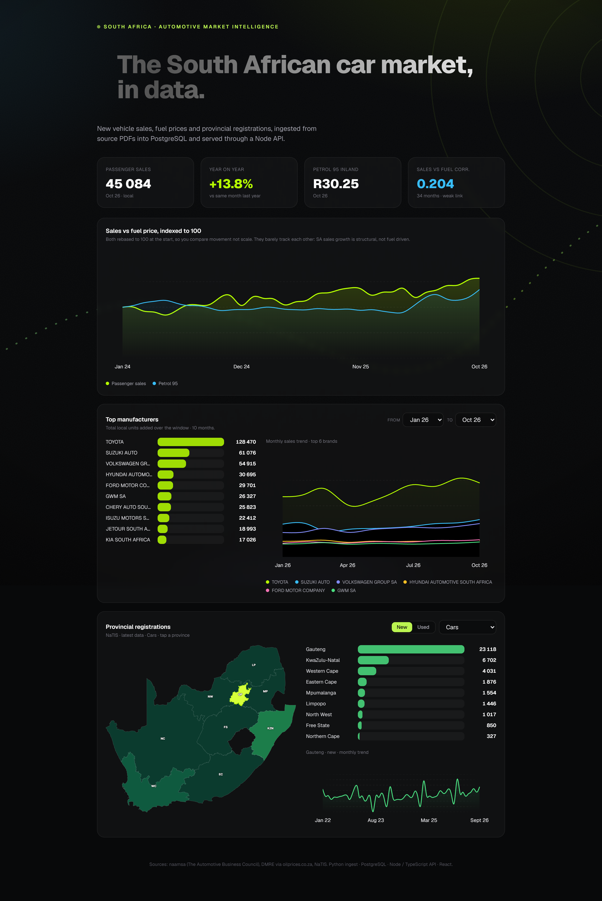

<div align="center">

# SA Auto Market Intelligence

**A full stack data app on the South African new vehicle market, built end to end from government and industry source documents, not a tidy API.**

`Python ingest` · `PostgreSQL` · `Node / TypeScript API` · `React + Vite dashboard`



</div>

## What it is

South Africa has no single clean feed for how its car market is moving. The numbers
exist, but they are scattered across monthly PDF reports and walled websites from
three separate bodies. This project pulls them together into one live, interactive view.

A Python layer lifts the figures out of source PDFs and HTML, loads them into a
normalised PostgreSQL schema, a Node and TypeScript API serves them, and a React
dashboard turns them into something you can actually read: new vehicle sales against
fuel prices, brand by brand trends over any date range, and vehicle registrations
across all nine provinces.

## Highlights

- **Sales vs fuel, indexed to 100.** Rebased so you compare movement, not scale. The two
  barely correlate (Pearson r around 0.20): local sales growth is structural, not driven
  by cheaper petrol.
- **Top manufacturers over a date range.** Pick a window and see which brands added the
  most units, with a per brand monthly trend line so you can watch the Chinese entrants
  (GWM, Chery, Jetour) climb into the top ten.
- **Provincial registrations.** An interactive choropleth of all nine provinces with a
  New / Used toggle, vehicle class filter and a date range that stacks the figures.
  Gauteng alone is over half of new car registrations.
- **A reusable PDF toolkit.** `pdfkit.py` makes PDF to Postgres a repeatable pattern, so a
  new source is a thin mapping file, not a rewrite.

## Data sources

Every figure is liberated from a source document. None of these publish a clean API, so
the interesting work is the ingest.

| Source | What | Format | Coverage |
|---|---|---|---|
| **naamsa** (Automotive Business Council) | new vehicle sales by manufacturer and segment | monthly PDF flash reports | 2023-01 to present |
| **DMRE** (via oilprices.co.za mirror) | petrol, diesel and paraffin prices | monthly HTML table | 2024-01 to present |
| **NaTIS** | vehicle registrations (new and used) by province and class | monthly PDF | 2022 to present |

## Architecture

```
ingest/            Python: PDF/HTML to PostgreSQL
  pdfkit.py          reusable toolkit: fetch (PDF verified) + table extract + number parse + upsert
  naamsa.py          naamsa flash report mapping
  naamsa_backfill.py discovers reports via the WordPress media API, backfills the series
  fuel.py            fuel price scrape
  natis.py           province x class parse by word x-position (handles spaced thousands)
db/schema.sql      normalised schema (sales, fuel, registrations, reference tables)
api/               Node + TypeScript + Express + pg (runs natively on Node 23+, no build step)
frontend/          React + Vite + Tailwind v4, visx animated charts, Geist type, d3-geo province map
```

## Engineering notes

- **`pdfkit`** is a small reusable layer (fetch, verify, table extract, number tokenizer,
  idempotent upsert). Each source is a thin mapping on top, so adding a PDF source is a new
  mapping file rather than a rewrite.
- **NaTIS PDFs do not extract as clean tables** (spaced thousands, numbers embedded in class
  labels), so rows are parsed by **word x-position**, bucketing each digit into its province
  column. Validated by checksum: the nine provinces sum to the PDF's own printed total.
- **Charts follow one rule strictly: no dual axis.** Sales and fuel are indexed to 100 on a
  single axis, the correct way to compare two different scales.
- **The province map** is built at compile time: GeoJSON to a d3-geo projection to bundled SVG
  paths, so there is no runtime map library. Ring winding is corrected for d3-geo's spherical
  convention.

## Run it locally

```bash
# 1. database
createdb sa_auto_market && psql sa_auto_market -f db/schema.sql
cp .env.example .env    # fill in your Postgres credentials

# 2. ingest
pip install pdfplumber psycopg2 requests beautifulsoup4
python ingest/naamsa_backfill.py discover && python ingest/naamsa_backfill.py ingest
python ingest/fuel.py
python ingest/natis.py discover && python ingest/natis.py ingest

# 3. api  (Node 23+)
cd api && npm install && npm start            # :4100

# 4. dashboard
cd frontend && npm install && npm run buildmap && npm run dev   # :5273
```

No secrets are committed. Database credentials live in a git ignored `.env`; see
`.env.example` for the shape.

## Licence

MIT. Data belongs to its respective sources (naamsa, DMRE, NaTIS) and is used here for
analysis with attribution, not redistributed.
